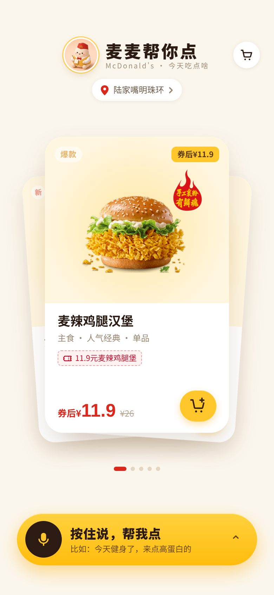
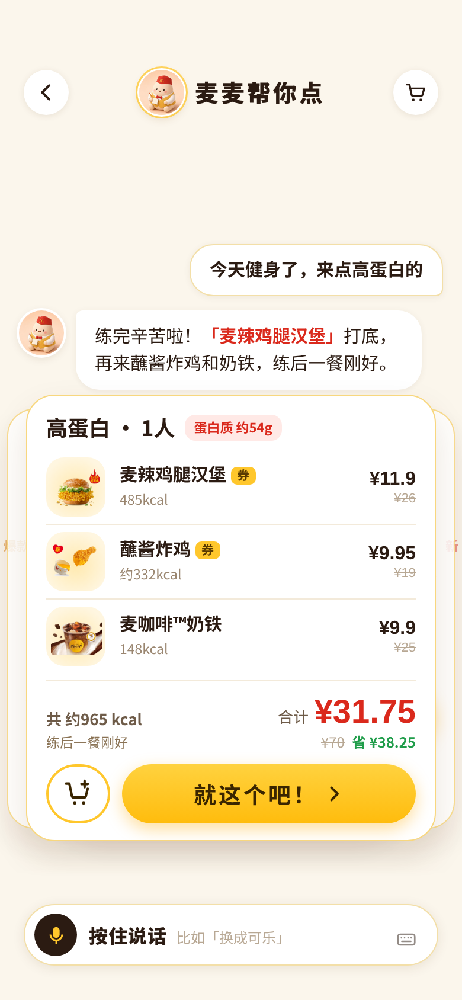
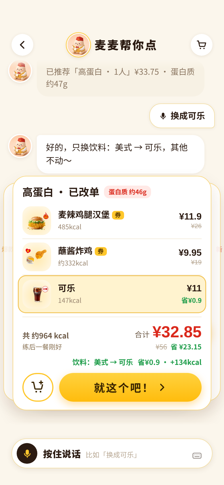

# 麦麦帮你点

**不想纠结吃什么？对麦麦说一句今天的状态，它帮你配好一餐。**

> 这是我为「麦当劳程序员节创意开发大赛」做的个人作品，**不是麦当劳官方产品**。热量、价格仅供参考，以麦当劳官方渠道为准。

## 马上试试

👉 **[打开体验：xinran0911.github.io/maimai](https://xinran0911.github.io/maimai/)**

- 手机或电脑都行，建议用 **Safari / Chrome** 打开。
- 按住底部的「按住说，帮我点」说话，第一次会问你要麦克风权限，点允许。
- 在小红书、微信里打开如果不能说话，点右上角「在浏览器打开」；实在不行也可以点键盘图标打字。

## 它的价值

**1. 点单更快：语音点单和推荐算法一起上**
传统点餐要先翻菜单、一样样选、再凑套餐、算优惠。麦麦把这几步并成一步：你开口说，它同时做两件事，一边听懂你要什么，一边用推荐算法按你的状态、人数、预算挑出一整套搭配，价格、热量、优惠都算好。首页还有新品、爆款两条卡片流，想随便看看也能一滑就加购。

**2. 说人话就能点准：用自然语言高效匹配**
你不用知道菜名，也不用会筛选。「今天健身了来点高蛋白」「昨天吃油了想清淡」「3个人预算100」，这些日常说法会被理解成具体的口味、状态、人数和预算，再对应到真实的菜单和营养数据。说得不对也不怕，接一句「换成可乐」就只改那一样，不用重来。

## 它为什么不一样

**它不做什么**
- 不让你翻菜单、一样样挑、自己凑套餐和算优惠。
- 不让大模型编价格和热量：所有数字来自麦当劳 MCP 或本地算法，回复里的数字对不上就会被重写或丢掉。
- 不真下单、不扣款：支付是演示用的假支付，只调用只读接口。

**它做什么**
- 听你说一句今天的状态、人数、预算，直接给一整套搭配。
- 语音点单和推荐算法并行，一次给出价格、热量和优惠。
- 不满意说一句话就只改那一样，并告诉你差价和热量变化。
- 模型或网络出问题时自动退回本地规则，照样能点。

一句话：多数点单是「你告诉它要什么」，麦麦是「你告诉它今天怎么样，它替你决定要什么」，而且每个数字都对得上真实数据。

## 它能做什么

你可以这样跟它说：

- 「今天健身了，来点高蛋白的」
- 「昨天吃得有点油，今天想清淡」
- 「3个人，预算100」

然后：

1. **给你一套餐卡**：有哪几样、各多少钱、一共多少热量、蛋白质多少，还有用了什么优惠，一眼看完。
2. **不满意就直接说**：「换成可乐」，只换那一样，并告诉你贵了还是便宜了多少。
3. **左右滑看别的搭配**：满意就点「就这个吧！」，或者先点小购物车图标放进购物车。
4. **首页也能直接逛**：新品和爆款两条顺序的卡片，左右滑动，喜欢的一键加购。
5. **走到结算页**：价格是真算的，**支付是演示用的假支付，不会真的下单、不会扣钱**。

## 长这样

### 设计稿（Figma）

| 首页 | 对话里推荐一餐 | 语音改单 | 确认订单 |
|---|---|---|---|
|  |  |  |  |

### 现在的 Demo 截图

| 首页 | 说一句话，出餐卡 | 说「换成可乐」 |
|---|---|---|
|  |  |  |

> 设计稿是交互稿 v1，做 Demo 时我又调整了几处（例如首页改成新品、爆款两条浏览顺序，餐卡底部改成「购物车图标 + 就这个吧！」两个按钮）。

## 数据从哪来

菜单、营养、价格和优惠来自**麦当劳 MCP**（菜单和营养实拉，价格用它的算价能力）。只用只读的接口，**不会真的下单**。接入细节见 [MCP_INTEGRATION.md](MCP_INTEGRATION.md)。

## 线上版和完整版的区别

| | 线上体验版（上面的链接） | 完整版（自己运行） |
|---|---|---|
| 听懂你说的话 | 内置的规则解析，常见说法都能懂 | 接入大模型（DeepSeek），能自由聊天、查热量、改单、回答各种问题 |
| 需要什么 | 打开就能用 | 自己的 DeepSeek key 和麦当劳 MCP token |

想自己运行完整版，请看 [docs/DEVELOPMENT.md](docs/DEVELOPMENT.md)。运行需要把密钥放在环境变量里（参考 [mcp-config.example.json](mcp-config.example.json)），仓库里没有任何真实密钥。

## 文档

- [CONTEST_DECLARATION.md](CONTEST_DECLARATION.md)：参赛声明
- [MCP_INTEGRATION.md](MCP_INTEGRATION.md)：MCP 接入说明
- [docs/DEVELOPMENT.md](docs/DEVELOPMENT.md)：开发和运行说明
- [mcp-config.example.json](mcp-config.example.json)：配置示例（只有环境变量占位符）

觉得有意思的话，欢迎点个 Star ⭐
