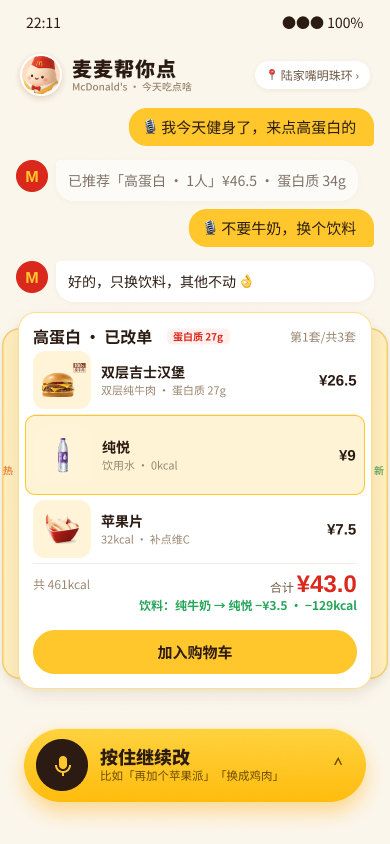
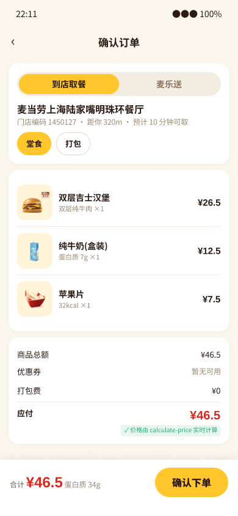

# 麦麦帮你点

### 😵 面对一屏密密麻麻的菜单，你是不是也会愣住？

看了五分钟，最后还是点了上次那一份。**麦麦帮你点**，就是给选择困难的人做的 🍔

它是你和整份菜单之间的桥：一头最懂你，一头最懂菜单 🌉

🎙️ 按住说一句就行：
- 「今天健身了，来点高蛋白」💪
- 「昨天吃太油了，想清淡点」🥗
- 「3 个人，预算 100」💰

营养、卡路里、预算、人数，它同时帮你算，一次配好一整套 ✅ 价格和热量都是实时查的真数据，不靠猜。饮料不想要？再说一句「换成可乐」🥤，只改这一样。

⚡ 知道想吃什么，一句话点完。
🎲 不知道吃什么，随便逛逛，首页左右滑，刷到心动的就加。

做那个最懂你、不让你再纠结的朋友 🤝

> 这是我为「麦当劳程序员节创意开发大赛」做的个人作品，**不是麦当劳官方产品**。热量、价格仅供参考，以麦当劳官方渠道为准。

## 马上试试

👉 **[打开体验：xinran0911.github.io/maimai](https://xinran0911.github.io/maimai/)**

- 手机或电脑都行，建议用 **Safari / Chrome** 打开。
- 按住底部的「按住说，帮我点」说话，第一次会问你要麦克风权限，点允许。
- 在小红书、微信里打开如果不能说话，点右上角「在浏览器打开」；实在不行也可以点键盘图标打字。

## ✨ 它的价值

**😌 治选择困难**
不用在几十个选项里反复比。说一句今天的状态，它给你一整套，还附一句理由，你只管说「行」或者「换一下」。

**⚡ 点得更快**
传统点餐要翻菜单、挑、凑套餐、算优惠。现在一句话全包，价格、热量、优惠它同时算好。

**🎯 比自己翻更准**
营养、卡路里、预算、人数，它一起考虑。每个数字都来自麦当劳 MCP 或本地算法，不让大模型编。

**🎲 随便逛逛**
有时候你根本不知道吃什么。那就不用说话，首页左右滑，新品、爆款一张张刷，看到心动的直接加购，像开盲盒一样。

## 🚫 它不做什么

- 不逼你翻菜单、一样样挑、自己凑套餐算优惠。
- 不让大模型编价格和热量。

## 它能做什么

你可以这样跟它说：

- 「今天健身了，来点高蛋白的」
- 「昨天吃得有点油，今天想清淡」
- 「3个人，预算100」

然后：

1. **给你一套餐卡**：有哪几样、各多少钱、一共多少热量、蛋白质多少，还有用了什么优惠，一眼看完。
2. **不满意就直接说**：「换成可乐」，只换那一样，并告诉你贵了还是便宜了多少。
3. **左右滑看别的搭配**：满意就点「就这个吧！」，或者先点小购物车图标放进购物车。
4. **首页也能直接逛**：新品和爆款两条顺序的卡片，左右滑动，喜欢的一键加购。
5. **走到结算页**：价格是真算的，**支付是演示用的假支付，不会真的下单、不会扣钱**。

## 长这样

### 设计稿（Figma）

| 首页 | 对话里推荐一餐 | 语音改单 | 确认订单 |
|---|---|---|---|
|  |  |  |  |

### 现在的 Demo 截图

> 设计稿是交互稿 v1，做 Demo 时我又调整了几处（例如首页改成新品、爆款两条浏览顺序，餐卡底部改成「购物车图标 + 就这个吧！」两个按钮）。

## 数据从哪来

菜单、营养、价格和优惠来自**麦当劳 MCP**（菜单和营养实拉，价格用它的算价能力）。只用只读的接口，**不会真的下单**。接入细节见 [MCP_INTEGRATION.md](MCP_INTEGRATION.md)。

## 线上版和完整版的区别

| | 线上体验版（上面的链接） | 完整版（自己运行） |
|---|---|---|
| 听懂你说的话 | 内置的规则解析，常见说法都能懂 | 接入大模型（DeepSeek），能自由聊天、查热量、改单、回答各种问题 |
| 需要什么 | 打开就能用 | 自己的 DeepSeek key 和麦当劳 MCP token |

想自己运行完整版，请看 [docs/DEVELOPMENT.md](docs/DEVELOPMENT.md)。运行需要把密钥放在环境变量里（参考 [mcp-config.example.json](mcp-config.example.json)），仓库里没有任何真实密钥。

## 文档

- [CONTEST_DECLARATION.md](CONTEST_DECLARATION.md)：参赛声明
- [MCP_INTEGRATION.md](MCP_INTEGRATION.md)：MCP 接入说明
- [docs/DEVELOPMENT.md](docs/DEVELOPMENT.md)：开发和运行说明
- [mcp-config.example.json](mcp-config.example.json)：配置示例（只有环境变量占位符）

觉得有意思的话，欢迎点个 Star ⭐
